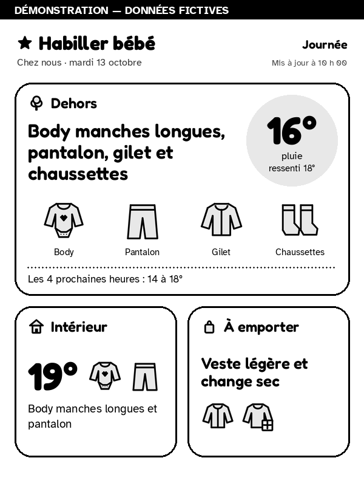
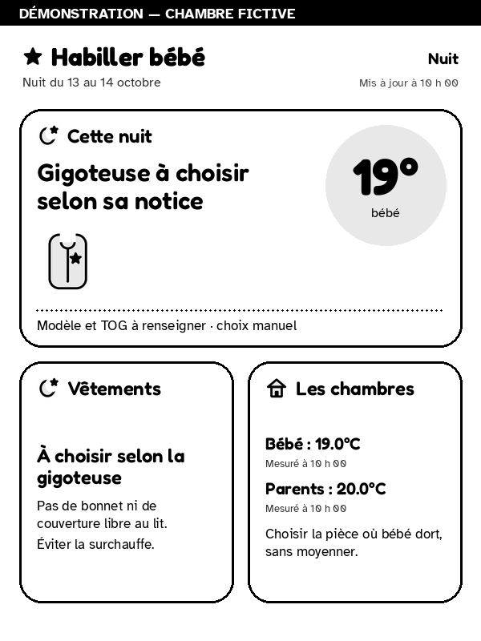

# How to dress baby

**A baby clothing guide at a glance, on a Kindle you already own.**

How to dress baby uses Home Assistant weather and room sensors to suggest a
starting outfit for the day and show bedroom temperatures at night. It turns
that information into a simple, illustrated display for a jailbroken Kindle.

Runs locally. No runtime AI, cloud rendering service, or subscription required
by this app.

<p>
  
  
</p>

*Day and night previews use sample data. The display is currently in French.*

## What it does

- **Suggests what to wear now** from the outdoor air temperature, with extra
  layers to bring and current weather beside the outfit.
- **Shows actual room temperatures**, including separate readings for the baby's
  and parents' bedrooms. Sleep sack and TOG choices stay with you.
- **Switches between day and night automatically** and warns when readings are
  missing or too old to use.
- **Keeps the Kindle display simple:** grayscale illustrations, readable text,
  and a low-battery reminder when battery reporting is configured.

> **A starting point, not medical advice.** Clothing thresholds are adjustable
> rules of thumb, not clinically validated cutoffs. Check your baby's comfort
> and adapt for transport, coverings and changing conditions. See the
> [clothing guidance and sources](docs/clothing-guidance.md).

## What you need

- **Home Assistant OS**, with a weather entity and room temperature sensors.
- **A compatible jailbroken Kindle** with a screensaver downloader. Tested on a
  Kindle Basic 8th generation (KT3), firmware 5.12.5, at 600 × 800 pixels. Other
  devices and firmware need verification.
- **A trusted local network** connecting Home Assistant and the Kindle.

You can preview the app in demo mode before connecting sensors or a Kindle.
The app does not jailbreak your device or install its downloader.

## Get started

1. In Home Assistant, open **Settings → Apps → App store**
   (**Add-ons → Add-on store** on older versions).
2. Open **⋮ → Repositories** and add:

   ```text
   https://github.com/somaticbits/how-to-dress-baby
   ```

3. Install **How to dress baby**, start it with demo mode enabled, then select
   **Open Web UI** to see the display.
4. In the app's configuration, select your weather and room sensor entities,
   then turn off demo mode. See the [configuration guide](docs/setup.md).
5. Follow the [Kindle setup guide](docs/kindle.md) and point its downloader to:

   ```text
   http://YOUR_HA_LAN_IP:8000/display.png
   ```

**Keep port 8000 on your trusted LAN.** The image service has no authentication;
do not expose it to the Internet. Home Assistant supplies its own API credentials
to the app, so no API token is needed for this installation.

## How the suggestions work

The app uses outdoor **air temperature**, not “feels like,” to choose a baseline
outfit. Wind and rain inform carried layers rather than artificial temperature
penalties. For example, the default at **16°C** is a long-sleeved
body, trousers, socks and a removable lightweight cardigan.

Indoor advice uses room sensors independently. At night, the app never guesses
where the baby sleeps or chooses a sleep sack's insulation for you.

## Documentation

- [Configuration, updates and migration](docs/setup.md)
- [Kindle setup and network troubleshooting](docs/kindle.md)
- [Clothing guidance, safety and evidence](docs/clothing-guidance.md)
- [Development and architecture](docs/development.md)
- [Changelog](CHANGELOG.md)

## Help and contributions

Found a bug or have an idea? [Open an issue](https://github.com/somaticbits/how-to-dress-baby/issues).
For display or device problems, include the app version, Kindle model and steps
to reproduce. Remove tokens, private configuration and household data before
sharing logs or screenshots.

Contributions are welcome. See the [development guide](docs/development.md)
for local setup and checks. Maintained by [somaticbits](https://github.com/somaticbits).

## License

[MIT](LICENSE) for the application and original illustrations. Bundled fonts and
dependencies are covered in the [third-party notices](THIRD_PARTY_NOTICES.md).
